# OpenKimo 使用教程

> 覆盖版本 **v0.3.0**。截图取自一台真实运行的 macOS 桌面版实例（浅色主题，中文界面），
> 演示数据是一个叫 `openkimo-demo` 的订单分析小项目。部分截图拍于更早的版本，
> 和现在的界面有出入的地方，以文字为准。

**目录**

1. [五分钟跑起来](#1-五分钟跑起来)
2. [界面总览](#2-界面总览)
3. [会话](#3-会话)
4. [对话](#4-对话)
5. [审批与安全](#5-审批与安全)
6. [Admin Panel](#6-admin-panel)
7. [进阶](#7-进阶)
8. [排错](#8-排错)
9. [附录](#9-附录)

---

## 1. 五分钟跑起来

### 1.1 OpenKimo 是什么

一个**跑在服务端的 Agent 平台**：你在浏览器里跟它对话，它在自己的环境里读文件、改代码、跑命令。
Docker 部署时每个会话跑在一个独立容器里；桌面版（.app / .exe）为了轻量，直接跑在本机进程上。

### 1.2 选一条安装路线

| 路线 | 需要什么 | 每会话独立容器 | 适合谁 |
|---|---|---|---|
| **A. macOS 应用** | 只要一台 Mac | ❌ 本机进程 | 个人用，想最快看到界面 |
| B. Docker Compose | Docker Engine | ✅ | 服务器、团队共用 |
| C. Windows 应用 | 一台 Windows | ❌ | Windows 用户 |

> 沙箱隔离、Jupyter、无头浏览器这三样只在 Docker 路线下开启。桌面版启动时会强制
> `KIMO_USE_CONTAINERS=false`、`ENABLE_BROWSER=false`、`ENABLE_JUPYTER=false`，这是取舍不是 bug。

### 1.3 路线 A：macOS 应用

从 [Releases](https://github.com/goldenxingxing/OpenKimo-releases/releases) 下载 `OpenKimo-*.dmg`，打开后把
`OpenKimo.app` 拖进 `Applications`，再从启动台打开。启动后它不占 Dock，只在菜单栏留一个图标。

还没填过 LLM 配置的话要先填一次（见下一节）。填完之后菜单栏状态变成
`● Running · port 5494`，浏览器打开 `http://127.0.0.1:5494` 就是 Web UI。

桌面版把数据放在这几个地方，备份和排错都看它们：

| 路径 | 内容 |
|---|---|
| `~/Library/Application Support/OpenKimo/.env` | Settings 窗口写入的配置（含 API Key） |
| `~/Library/Application Support/OpenKimo/sessions/` | 会话历史、`users.db`、`config.toml` |
| `~/Library/Application Support/OpenKimo/skill/` | 你上传的 Skill |
| `~/Documents/OpenKimo/` | 默认工作目录 |
| `~/Library/Logs/OpenKimo/server.log` | 服务端日志 |

<details>
<summary><b>路线 B：Docker Compose（服务器部署）</b></summary>

```bash
curl -O https://raw.githubusercontent.com/goldenxingxing/OpenKimo-releases/main/docker-compose.yml
curl -O https://raw.githubusercontent.com/goldenxingxing/OpenKimo-releases/main/.env.example
cp .env.example .env
# 编辑 .env，至少填一个 API Key，并把 KIMO_WEB_SESSION_TOKEN 改成随机串
docker compose up -d
```

打开 `http://<服务器地址>:5494`。这条路线下每个会话一个容器，CPU / 内存 / 磁盘 / 进程数都有上限，
见 [附录 A](#附录-a-常用环境变量)。
</details>

<details>
<summary><b>路线 C：Windows</b></summary>

从 [Releases](https://github.com/goldenxingxing/OpenKimo-releases/releases) 下载 Windows 安装包，装好后注意一点：**Shell 工具需要 Git for Windows**，
没装的话界面顶部会出现一条横幅，点里面的链接装完再刷新即可。
</details>

### 1.4 Settings 窗口

**它不一定会自己弹出来。** 想什么时候开都行：点菜单栏那个 OpenKimo 图标 → **Settings…**（快捷键 `⌘,`）。

菜单里还有这些：

| 菜单项 | 作用 |
|---|---|
| `● Running · port 5494` | 服务状态。也可能是 `Starting…`、`Stopped`、`Crashed (see logs)` |
| Open Web UI `⌘O` | 用默认浏览器打开 Web UI |
| Open Admin | 直接打开 `/admin` |
| Start Server / Stop Server | 起停服务 |
| Restart Server | 重启服务 |
| **Settings…** `⌘,` | 本节的主角 |
| Open Config Folder | 打开 `~/Library/Application Support/OpenKimo/` |
| View Logs | 打开日志目录 |
| Install Package… | 给内置 Python 装第三方包（agent 跑脚本时要用的库） |
| Open Terminal Here | 在工作目录开一个终端 |
| About / Quit `⌘Q` | 关于 / 退出（退出会一并停掉服务） |

#### 第一次打开：一个 provider 都没有

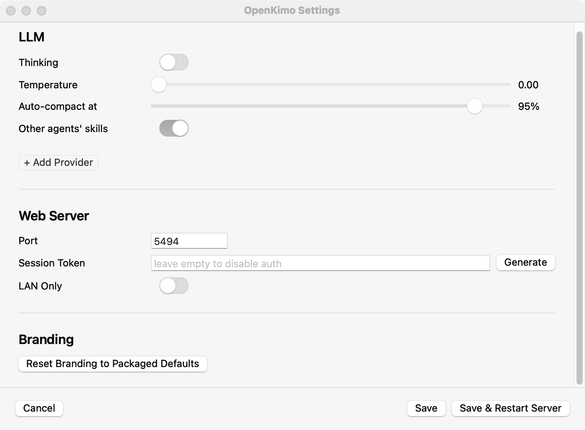

LLM 段下面只有一个 `+ Add Provider` 按钮 —— 这时候服务是起不来的，得先加一个 provider。

#### 填一个 provider

点 `+ Add Provider`，出来一整组字段，填完长这样：

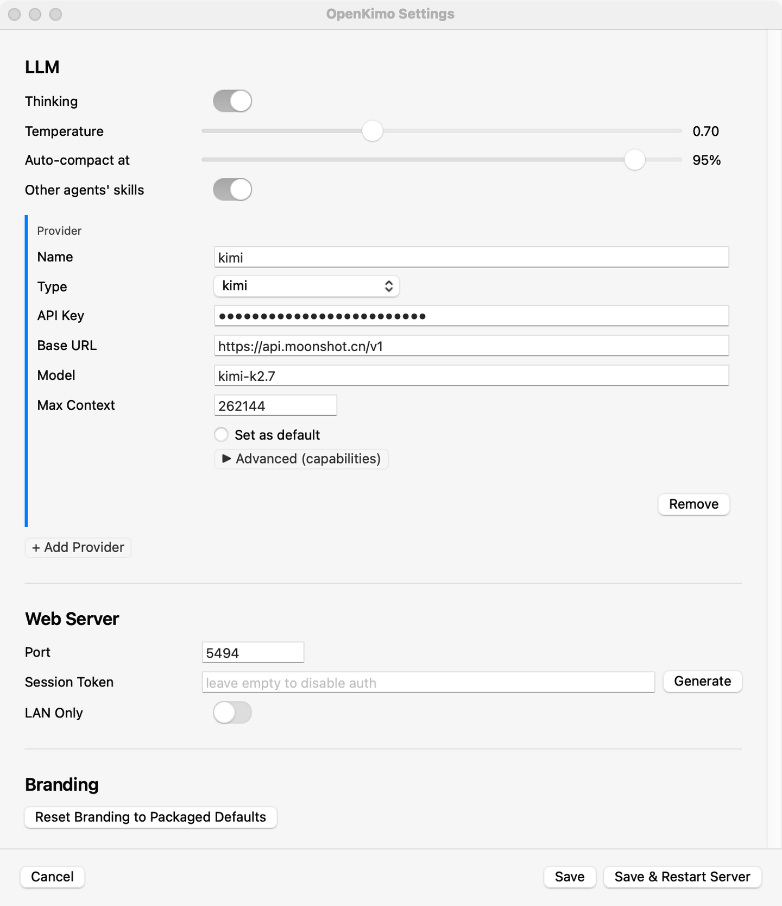

| 字段 | 填什么 |
|---|---|
| **Name** | 你自己给它起的名字，之后会出现在 Web UI 的模型切换器里。随便起，但别重名 |
| **Type** | 走哪套协议。下拉里只有三个：`kimo` / `openai_legacy` / `anthropic` |
| **API Key** | 供应商给的密钥，输进去显示成圆点 |
| **Base URL** | 接口地址。用自建网关或中转就填自己的 |
| **Model** | 模型 ID，要跟供应商文档里写的一模一样，错一个字符就是 404 |
| **Max Context** | 上下文上限（tokens）。留空按 `1000000` 算 |
| **Set as default** | 新会话默认用哪个。**至少勾一个** |
| **Advanced (capabilities)** | 声明这个模型支持什么，见下 |

三家的常用值：

| 供应商 | Type | Base URL | Model 举例 | Max Context |
|---|---|---|---|---|
| OpenAI 及兼容端点 | `openai_legacy` | `https://api.openai.com/v1` | `gpt-4o` | `128000` |
| Anthropic | `anthropic` | `https://api.anthropic.com` | `claude-sonnet-5` | `1000000` |

配多个 provider 就再点一次 `+ Add Provider`；右下角的 `Remove` 删掉当前这个。

#### Advanced (capabilities)

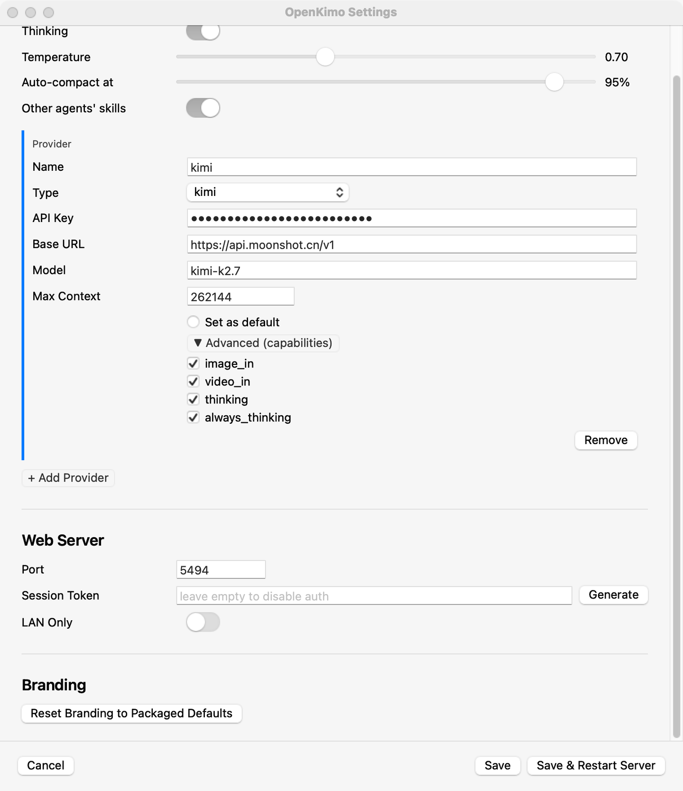

四个勾是**声明**，不是开关：告诉 OpenKimo 这个模型支持什么，界面据此决定放不放行。

| 能力 | 含义 |
|---|---|
| `image_in` | 能接收图片输入 |
| `video_in` | 能接收视频输入 |
| `thinking` | 支持思考模式 |
| `always_thinking` | 始终思考，关不掉 |

勾多了不会让模型变强，只会让界面允许你做它做不到的事 —— 比如给一个不支持视觉的模型传图，然后收到一个报错。
这几个勾最后会变成 Admin → Models 里那几个能力标签（[6.3](#63-models)）。

#### LLM 段剩下的四项

| 项 | 说明 |
|---|---|
| **Thinking** | 新会话默认开不开思考模式 |
| **Temperature** | 采样温度，0 最稳，越大越发散 |
| **Auto-compact at** | 上下文用到百分之多少自动压缩，默认 95% |
| **Other agents' skills** | 要不要把其它 agent 目录里的 skill（例如 `~/.claude/skills`）也一起合并进来 |

#### Web Server 段

| 项 | 说明 |
|---|---|
| **Port** | Web UI 端口，默认 `5494`。被占了就在这改 |
| **Session Token** | 留空 = 不校验 token。点 `Generate` 生成一串随机值；填了之后访问要带 `?token=<值>`。**机器不是只有你能碰就填上** |
| **LAN Only** | 只允许局域网访问 |

#### Branding 段

只有一个 `Reset Branding to Packaged Defaults`：把你在 Admin → Branding（[6.5](#65-branding)）里改过的 logo、名称、页面标题还原成打包时的默认值。

#### 保存

底部三个按钮：

- **Cancel** —— 丢弃改动关窗。
- **Save** —— 只写文件。**正在跑的服务还是旧配置**。
- **Save & Restart Server** —— 写文件并重启服务。改了 provider、端口、token 之后用这个。

写入位置是 `~/Library/Application Support/OpenKimo/.env`，而且只动它认识的那些键 —— 你自己在这个文件里加的注释和其它行不会被抹掉。

> Docker 路线没有这个窗口，等价物就是你手动编辑的 `.env`，字段名一一对应。

### 1.5 第一次登录

默认账号是 `admin` / `admin123`。

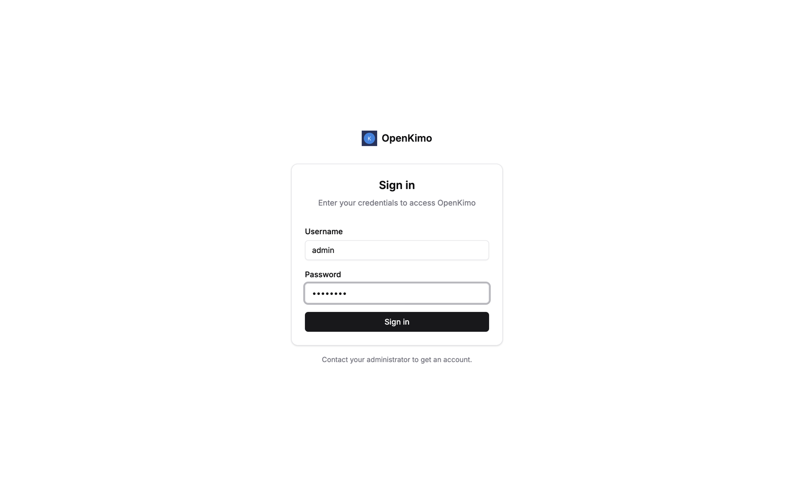

登录后**立刻**去 Admin Panel → Users → 钥匙图标改密码。默认口令写在 README 里，
等于没有密码。

如果服务端还开了 Bearer Token（`KIMO_WEB_SESSION_TOKEN`），地址要带上：
`http://localhost:5494/?token=<你的 token>`。

---

## 2. 界面总览

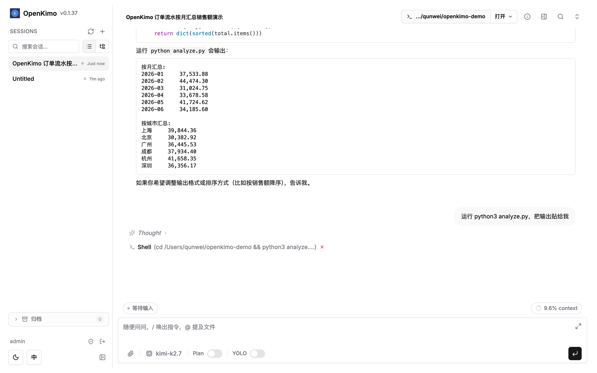

从左到右四块：

- **① 左侧会话栏** —— 顶部是搜索框和两个视图切换（列表 / 按目录分组），中间是会话列表，
  底部是「归档」抽屉、当前用户、管理面板入口（盾牌图标）、退出登录、深色模式、中英文切换、折叠侧边栏。
- **② 顶栏** —— 会话标题（双击改名）、工作目录 + 「打开」菜单、会话信息 ⓘ、工作区文件面板开关、
  搜索消息 🔍、折叠/展开所有块。
- **③ 中间对话区** —— 消息、思考块、工具调用、审批卡片都在这里。
- **④ 底部输入区** —— 输入框 + 附件、模型、Plan、YOLO 四个控件，右上角是上下文占用百分比。

右下角那颗小圆点和「等待输入」是**活动状态**，它会告诉你 agent 此刻在干什么。

深色主题（左下角月亮图标切换）：

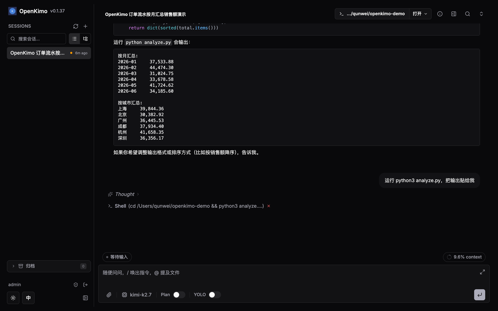

---

## 3. 会话

一个会话 = 一段对话 + 一个工作目录。agent 的所有读写默认发生在这个目录里。

### 3.1 新建会话

点侧边栏的 `+`，或空状态里的「新建会话」。

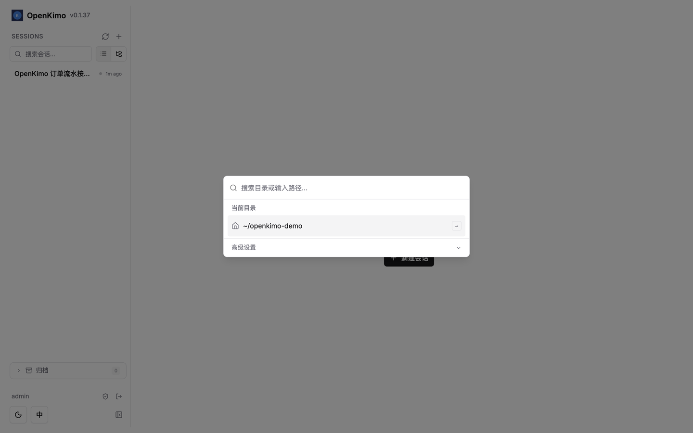

目录选择器有三组来源：**当前目录**（默认工作目录）、**最近使用的目录**、**自定义路径**（直接输路径回车）。
输入一个不存在的路径时，会先问你要不要创建这个目录。

展开「高级设置」有两个开关：

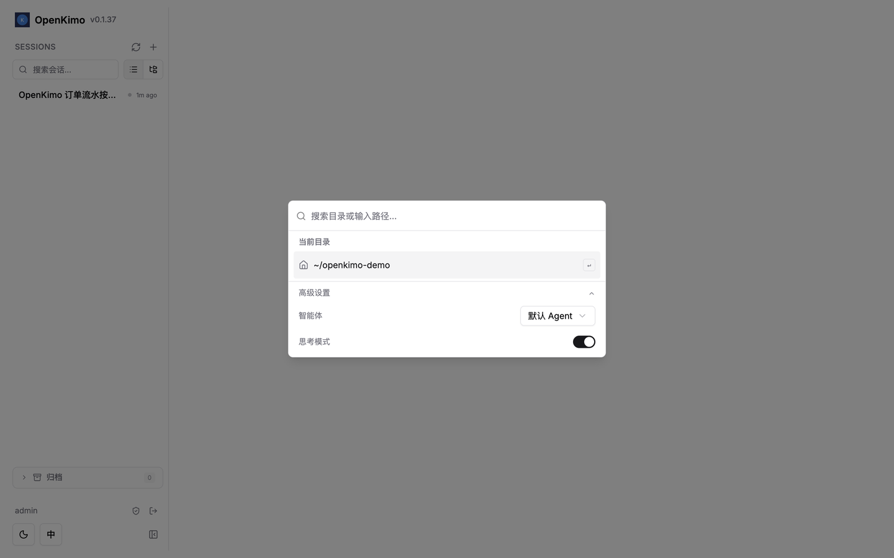

- **智能体** —— 选一个自定义 Agent。来源分「用户」（`~/.kimo/agents`）和「项目」（工作目录下 `.kimo/agents`），
  写法见 [`docs/CUSTOM-AGENTS.md`](CUSTOM-AGENTS.md)。
- **思考模式** —— 打开后模型会先想再答，回答里能看到可展开的 `Thought` 块。

### 3.2 会话列表上的操作

在会话上**右键**：

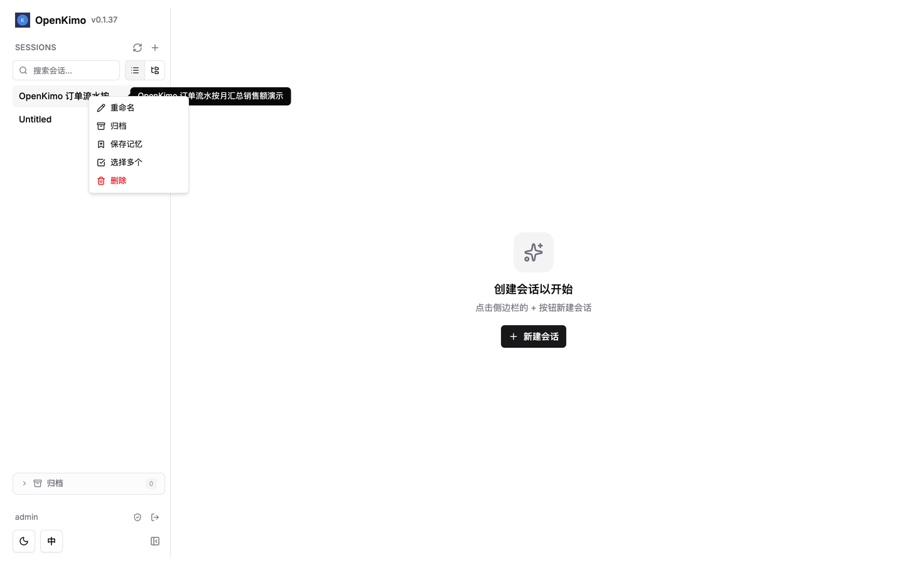

| 菜单项 | 作用 |
|---|---|
| 重命名 | 也可以双击顶栏标题 |
| 归档 | 收进底部的「归档」抽屉，不删数据 |
| 保存记忆 | 立刻把这段对话总结进记忆（见 3.4） |
| 选择多个 | 进入多选，批量归档/删除 |
| 删除 | 二次确认后不可恢复 |

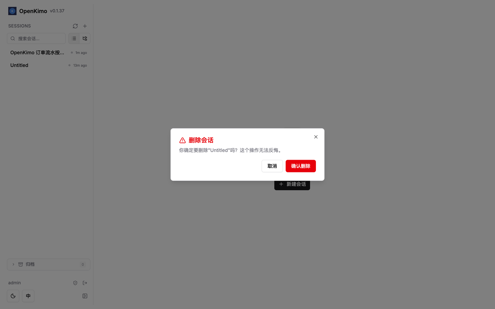

归档过的会话在左下角抽屉里，展开后可以「取消归档」：

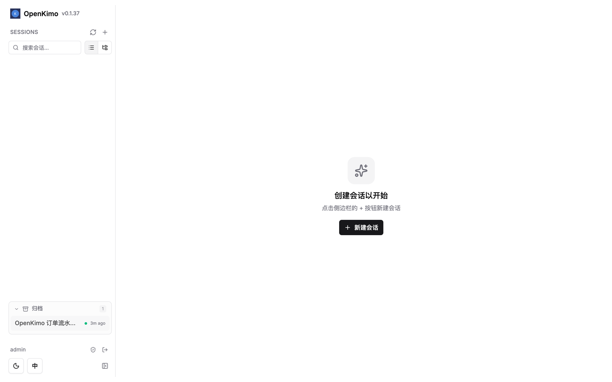

**当前打开的是哪个会话**：它在列表里底色更深，左边有一条蓝色竖线。

### 3.5 别的会话做完了，怎么知道

你在一个会话里干活时，别的会话可能已经回复完、在等你批准或回答问题，或者出了错。这时会有两处提示：

- **浏览器标签页标题**变成 `【需要你查看】<会话名>`；不止一个时是 `【N 个会话需要你查看】`，数字是还没看的会话数。
- **会话列表**里，这些会话的名字左边多一个实心圆点（浅色主题下是黑色），名字加粗。

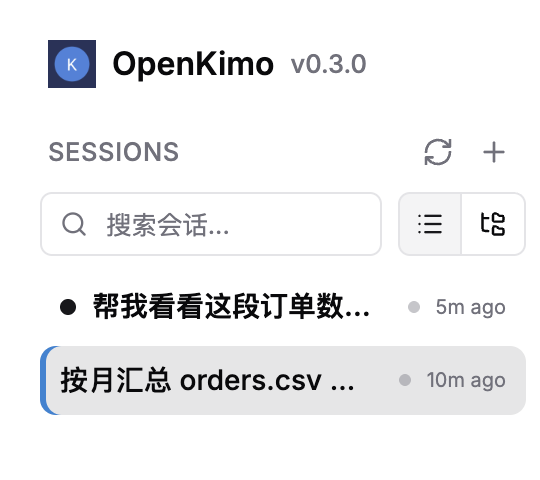

打开那个会话，提示就消失。名字**左边**这颗是「需要你查看」，**右边**那颗是记忆状态灯（[3.4](#34-记忆状态灯)），两者不是一回事。

### 3.3 会话信息与「打开」

ⓘ 会给出会话 ID、工作目录、会话目录，每项右边都有复制按钮 —— 排错时贴日志用得上：

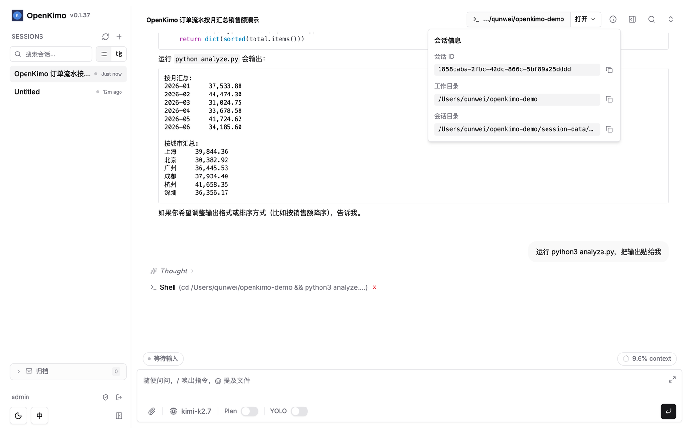

顶栏的「打开 ▾」用本机应用打开工作目录（VS Code、终端、访达……），也能只复制路径。
它会记住你上次用的应用：

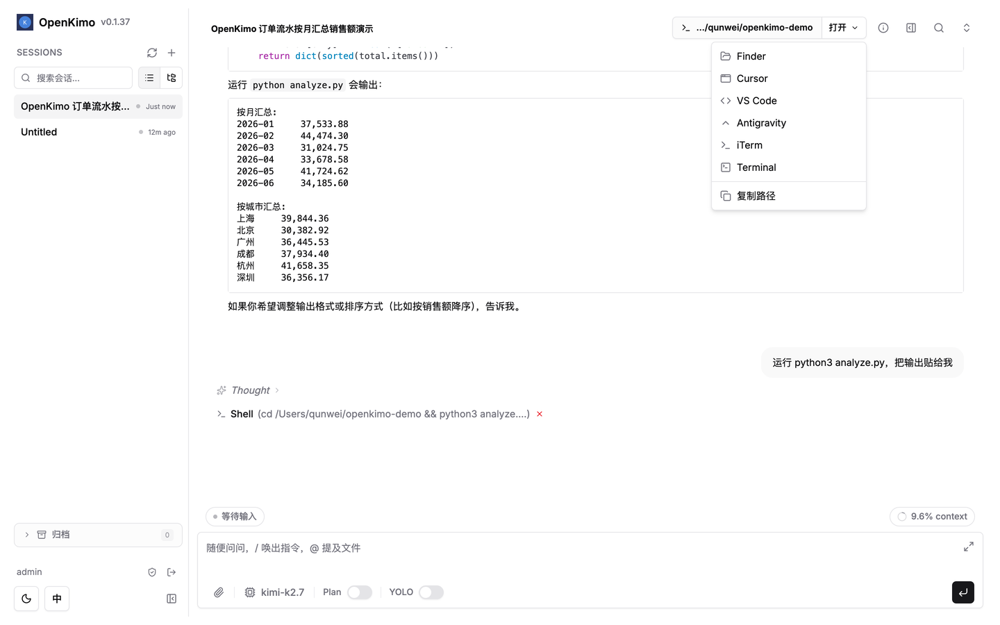

### 3.4 记忆状态灯

会话名字右边那颗小圆点，是这个会话的**记忆状态**：

| 颜色 | 含义 |
|---|---|
| 灰 | 尚未保存记忆 |
| 转圈 | 正在记录记忆… |
| 绿 | 记忆已是最新 |
| 黄 | 上次保存后又有新对话 |
| 红 | 上次保存失败 |

右键「保存记忆」可以手动触发。触发中：

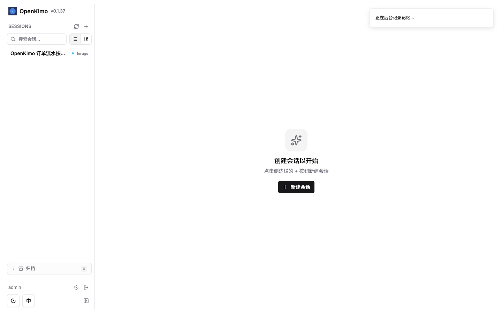

保存下来的东西去哪了？去 Admin Panel → Memory → Recent（见 [6.6](#66-memory)）。
如果记忆已经是最新，点它会直接告诉你「等有新对话的时候再试」，不会白跑一次模型调用。

---

## 4. 对话

### 4.1 输入框的四种状态

占位符会告诉你当前能不能发：`请先创建会话…` → `正在连接…` → `正在启动环境…` → `随便问问，/ 唤出指令，@ 提及文件`。

发送用回车；换行用 `Shift+回车`，macOS 上也可以用 `Cmd+回车`（其他系统 `Ctrl+回车`）。生成过程中回车会**排队**（按钮变成「排队发送」，输入区上方出现 `N Queued`），
生成结束后自动接着发。右边的方块按钮是**停止生成**。

**粘贴一大段文字**（超过 50 个字）时，输入框里不会铺满，而是在光标处放一个占位符，比如 `⟦粘贴 1 · 128 行⟧`。
它就是句子的一部分，可以写成「把 ⟦粘贴 1⟧ 翻译一下，再和 ⟦粘贴 2⟧ 对比」。光标停在占位符上时，
可以「查看全文」（能直接改）或「展开为文字」。发送时模型收到的是全文，放在占位符所在的位置。

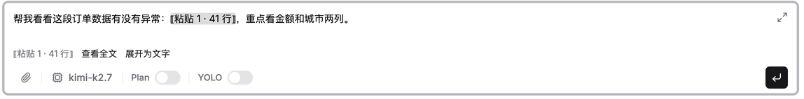

**文件**（粘贴、拖进来或用回形针添加）同样会在光标处留一个占位符，比如 `⟦文件 1 · report.csv⟧`，
所以也能写在句子中间，模型看到的文件就在你放的位置。

### 4.2 斜杠命令

输入 `/` 唤出命令面板：

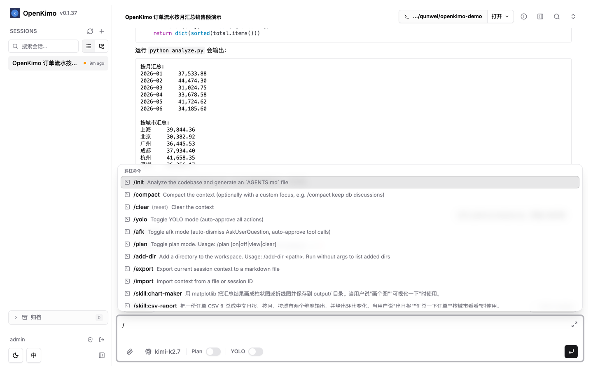

Web 端提供这 9 条：

| 命令 | 作用 |
|---|---|
| `/init` | 分析当前代码库，生成 `AGENTS.md` |
| `/compact` | 压缩上下文，可带重点，例如 `/compact keep db discussions` |
| `/clear`（`/reset`） | 清空上下文 |
| `/yolo` | 切换 YOLO 模式（自动批准所有操作） |
| `/afk` | 切换挂机模式（自动忽略提问、自动批准工具调用） |
| `/plan` | 切换 Plan 模式，`/plan [on\|off\|view\|clear]` |
| `/add-dir` | 把另一个目录加进工作区；不带参数则列出已加入的目录 |
| `/export` | 把当前会话导出成 Markdown |
| `/import` | 从文件或会话 ID 导入上下文 |

装过的 Skill 会以 `/skill:<名字>` 的形式出现在同一个面板里，这是显式调用它的入口：

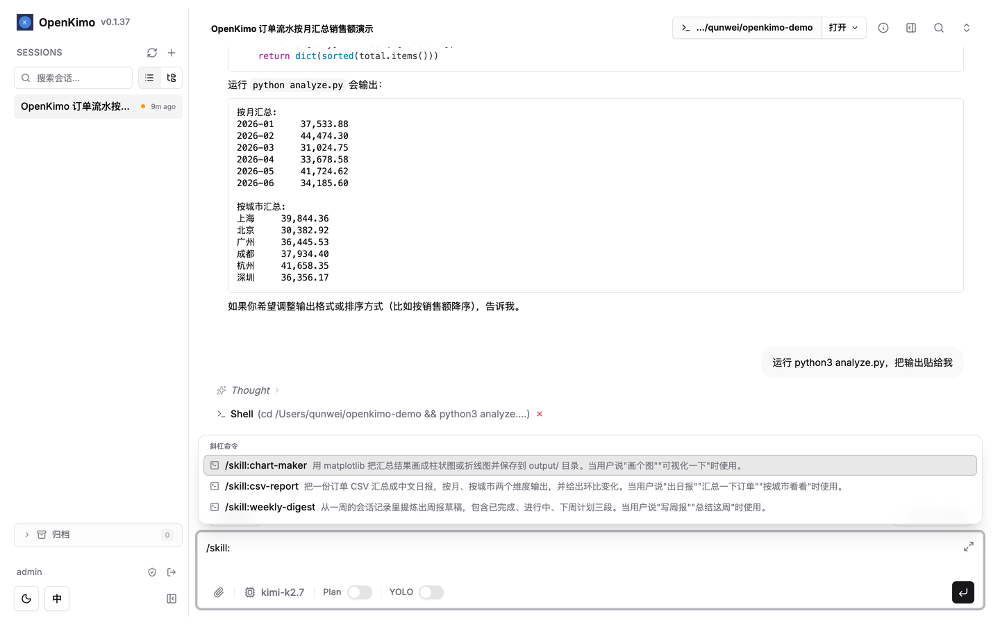

### 4.3 `@` 提及文件

输入 `@` 打开文件选择器，列出工作区里可提及的文件；正在上传的附件会单独标一个「待上传」分组。
文件多的时候直接接着输路径片段做深层搜索。

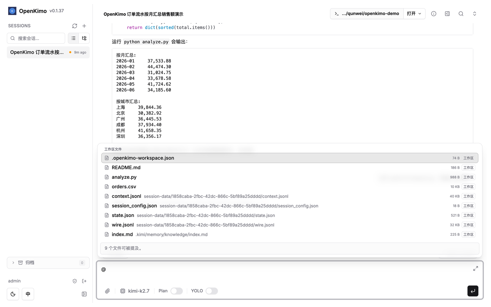

### 4.4 Plan 模式

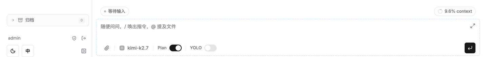

打开后模型**只读**：只调研、只规划，不改文件。适合让它先讲清楚打算怎么做，你点头了再放开。

### 4.5 YOLO 模式

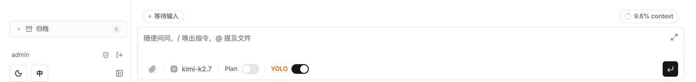

跳过**所有**审批 —— 执行命令、改文件、删文件都不再问。等价于 `/yolo`。
桌面版没有容器隔离，agent 跑的命令就是在你本机跑，所以这个开关请当成一次明确的授权来用，
用完关掉。

### 4.6 活动状态

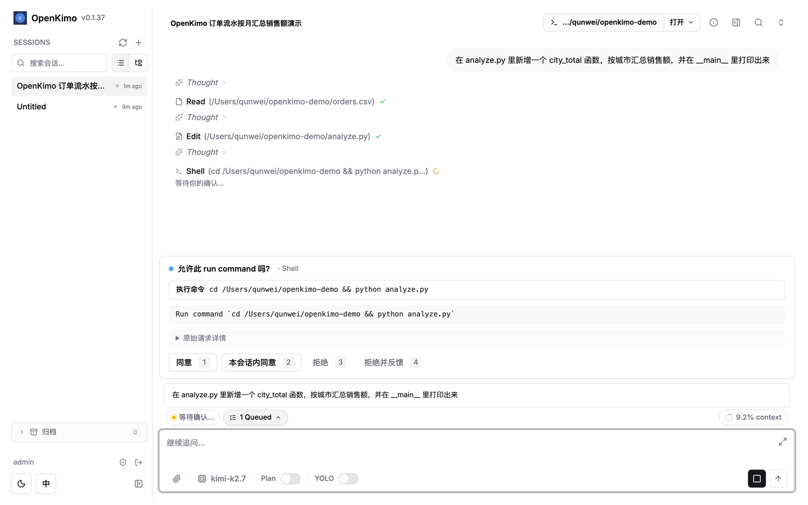

状态条会具体到工具：正在读取文件 / 正在编辑代码 / 正在运行命令 / 正在搜索内容 /
正在获取网页内容 / 正在运行代理……卡住时先看这里，再去看日志。

**模型服务端出问题时会一直重试。** 遇到限流、服务端报错、超时或连接中断，这一轮不会因为重试到一定次数就放弃，
而是一直重试，直到成功或你点「停止生成」。消息区会有一行说明现在的情况，例如：

`服务端限流 · 第 12 次重试 · 已持续 5 分 20 秒 · 30 秒后重试 · 点停止可中断`

两个细节：

- 页面关掉超过 **3 分钟**，还在重试的这一轮会自动停止，不会没人看着还一直重试。
- 子 agent 调模型也一样会重试。

服务端直接拒绝的请求（比如参数不对、Key 无效）不会重试，会立刻报错。

### 4.7 消息区

工具调用折叠成一行，点开看详情；`Thought` 块记录模型的思考和耗时（`Thought for 5s`）。
每条助手消息下面有 Copy 和 **Fork session**（从这条消息分叉出一个新会话）。

顶栏右上角两个按钮：**搜索消息** 和 **折叠/展开所有块**。搜索支持在正文、思考、工具输入输出里找，
左边是命中列表，右边是预览，回车跳转：

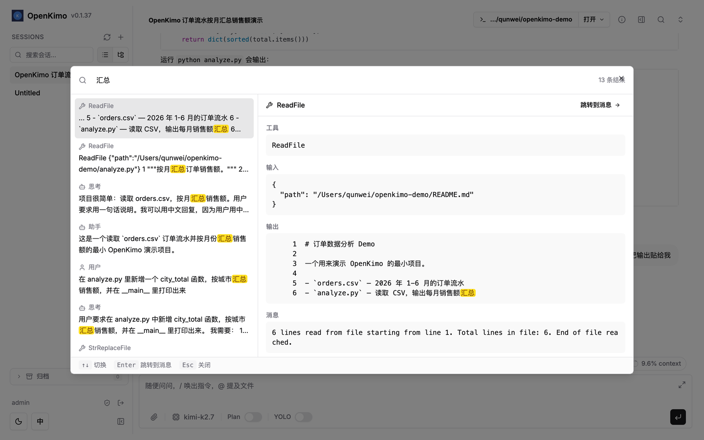

一次折叠所有块，长会话里找东西会快很多：

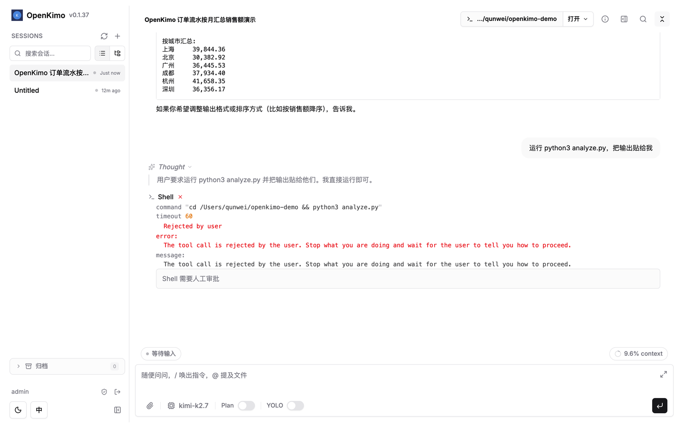

### 4.8 工作区文件面板

顶栏那个右侧面板图标打开它：当前工作目录、可以逐级进出目录、每个文件右边是下载按钮。

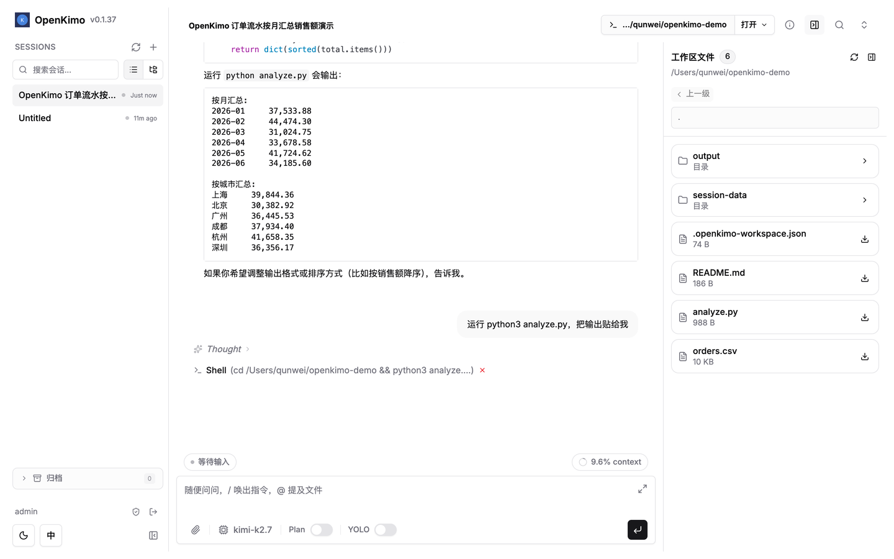

### 4.9 切换模型

点输入区里的模型名（例如 `k3`）：

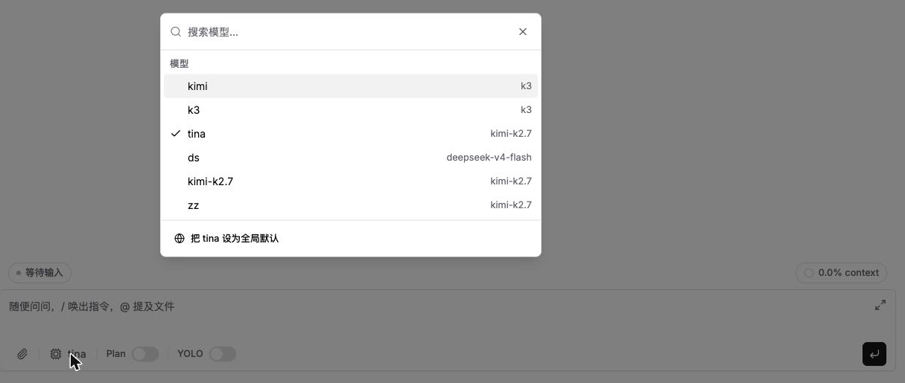

模型分**两层**，这个面板两层都能碰，但它们是两件事。

**选一个模型 —— 只影响当前会话。** 打勾的那个就是这个会话正在用的。选中之后
会话会重启一次（消息区会出现一行 `Session restarted`），别的会话不受影响。
一个会话从没选过模型，就一直跟着全局默认走 —— 包括全局默认**之后**被改动时。

选择器**在生成回答的过程中会拒绝切换**，并提示「正在生成回答，完成后才能切换模型」。
这不是保守：模型是在一轮开始时读取的，中途切了也不会生效，与其静默无效不如直接挡住。

会话还没创建时（在新建会话的输入框里）选的模型会**暂存**，等会话建好再套上去。

**「把 xxx 设为全局默认」 —— 面板底部那一行。** 它把当前选中的模型写成全局默认：
所有**没有自己模型**的会话都跟着变，空闲的会立刻重启用上新模型，正在忙的会被跳过
并告诉你跳过了几个 —— 这时旁边会多出一个「强制重启忙碌会话」按钮，点了连忙碌的
一起重启。当前模型已经是全局默认时，这一行显示「已经是全局默认」且不可点。

之所以做成单独一步，是因为它的影响面是整个工作区，而不是你眼前这个会话。

模型从哪来见 [6.3 Models](#63-models)。

### 4.10 一次完整的来回长什么样

让它加一个按城市汇总的函数，它读文件 → 改文件 → 想跑一下验证：

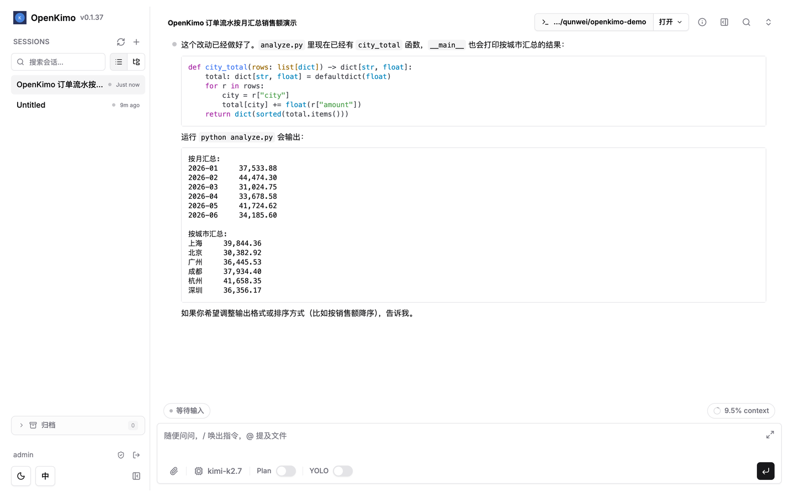

批准之后拿到真实输出，它把结果贴回来并问你要不要换排序：

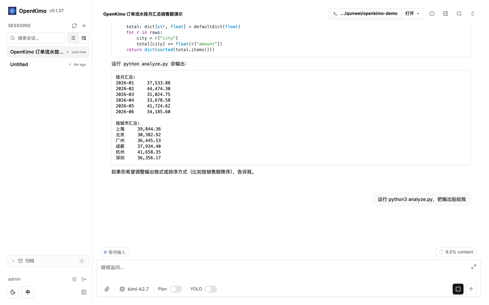

---

## 5. 审批与安全

### 5.1 审批卡片

agent 要做有副作用的事情时，会停下来问你：

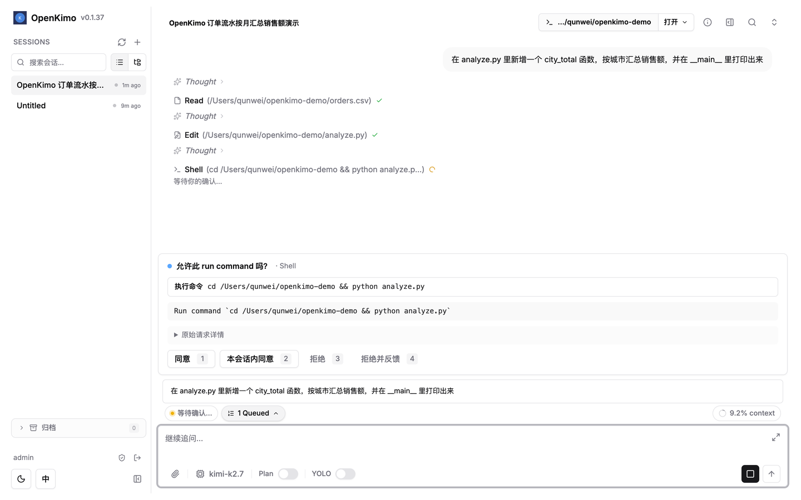

卡片分两部分：**摘要**（人话）和 **原始请求详情**（点开看完整参数）。摘要有五类：

| 类型 | 摘要长什么样 |
|---|---|
| 执行命令 | 完整命令行 |
| 修改文件 | diff，`3 → 7 行`、`共 2 个文件` |
| 更新待办 | `已完成 2/5` |
| 后台任务 | 任务描述 |
| 写入 Wiki | 页面列表、来源、被忽略的重复页 |

四个动作（键盘 `1` `2` `3` `4`）：

- **同意** —— 只放行这一次。
- **本会话内同意** —— 本会话里后续匹配的请求自动通过，卡片下面会显示「本会话已授权」。
- **拒绝** —— 工具执行取消，agent 收到拒绝结果。
- **拒绝并反馈** —— 拒绝的同时告诉模型该怎么做，比如"别用 rm，改成移到 trash 目录"。
  回车提交，`Shift+回车` 换行，`Esc` 取消。

被拒绝的调用在消息流里留一个红色 ✕，历史是完整的。

### 5.2 三道闸门

1. **危险命令拦截**（`BLOCK_DANGEROUS_COMMANDS=true`）—— `rm -rf /`、`mkfs`、`dd` 这类直接挡掉。
2. **人工审批** —— 就是上面这套卡片；YOLO / afk 会跳过它。写入知识库是个特例：afk 下仍然会弹卡片等你（见 [6.7](#67-知识库)）。
3. **容器隔离** —— 仅 Docker 路线：每个会话一个容器，CPU、内存、磁盘、进程数都有硬上限，
   超时自动销毁（默认 24 小时）。

细节见 [`docs/SECURITY_MODEL.md`](SECURITY_MODEL.md)。

---

## 6. Admin Panel

左下角盾牌图标进入，或直接访问 `/admin`。只有 `admin` 角色看得到。九个页签：
**Skill / Users / Models / Plugins / Branding / MCP / 知识库 / Memory / Evolution**。

### 6.1 Skill


上半部分是**用量统计**：7d / 30d / 90d 三个窗口，调用次数、用到的 skill 数、涉及会话数、
显式调用次数（即 `/skill:` `/flow:` 这种手动点名，大部分用量其实是模型自己读了 `SKILL.md`），
外加每日调用折线和 Top skills。

下半部分是 skill 列表，可以按 **最常用 / 最近 / 名称 / 分类** 排序。「Upload Skill」接受
一个包含单个 skill 的 ZIP，或一个独立的 `SKILL.md`；在 frontmatter 里写 `category:` 就能指定
它落到哪个分区，不写则按名字和描述自动分类。

展开一条能看到描述、`N file · N invocations · 上次使用`，以及 Edit / Disable / Delete：

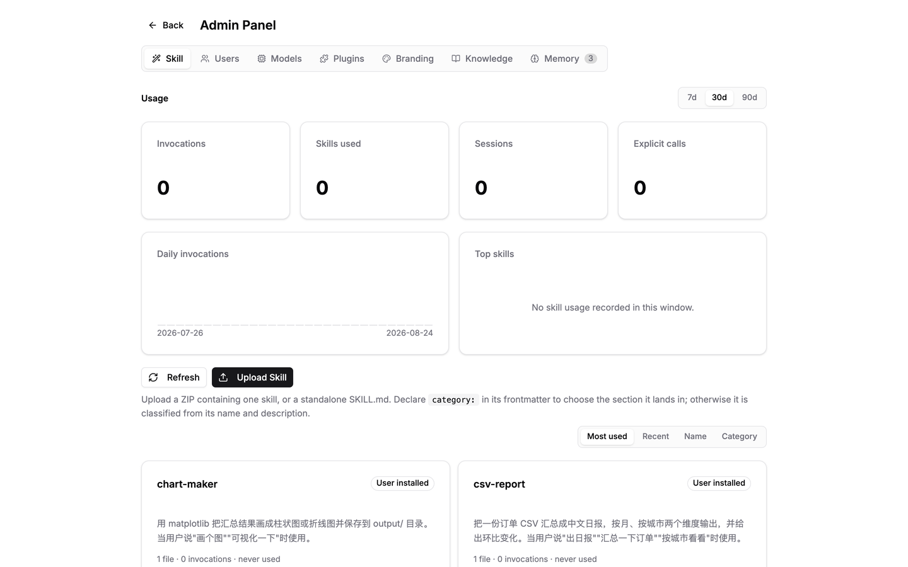

内置的标 `Built-in`，你传的标 `User installed`。传上去之后，它同时会出现在对话框的
`/skill:` 命令列表里。

**需要 npm 包的 skill。** 有的 skill 靠脚本干活，脚本又要用 npm 包（比如收发邮件的 skill），
而上传的 ZIP 带不了 `node_modules`。这种 skill 会标一个 `Needs dependencies`（鼠标放上去能看到缺了哪些包），
展开后点「Install dependencies」，包就装进这个 skill 自己的目录；带了 lock 文件的话用 `npm ci`，按作者锁定的版本装。
这一步需要本机装有 Node.js 和 npm。只有你上传的 skill 能装，内置 skill 在应用包里，不能改。

### 6.2 Users

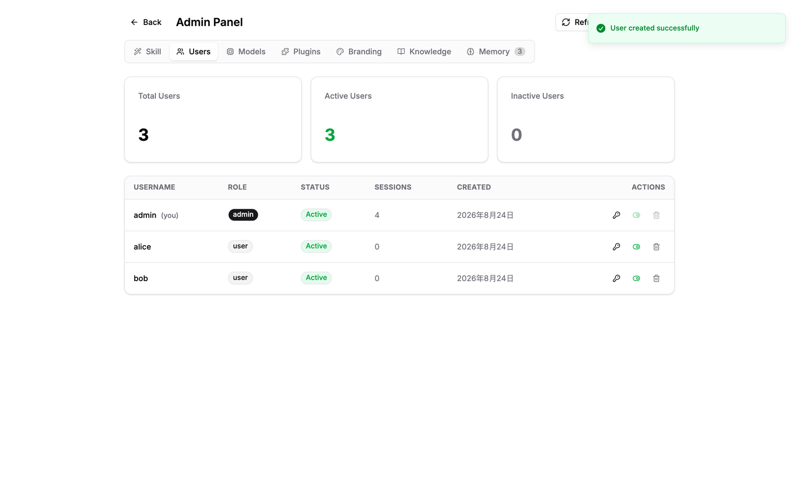

三张统计卡（总数 / 活跃 / 停用）加一张表，每行是用户名、角色、状态、会话数、创建时间。
右边三个按钮：重置密码、启用/停用、删除。**自己这一行的停用和删除是禁用的**，防止把自己锁在外面。

新建用户时选角色 `user` 或 `admin`：

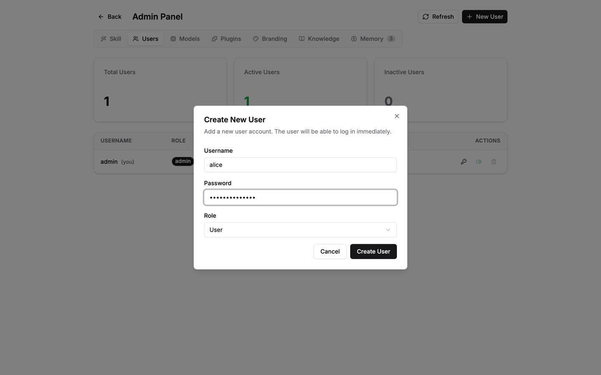

重置密码：

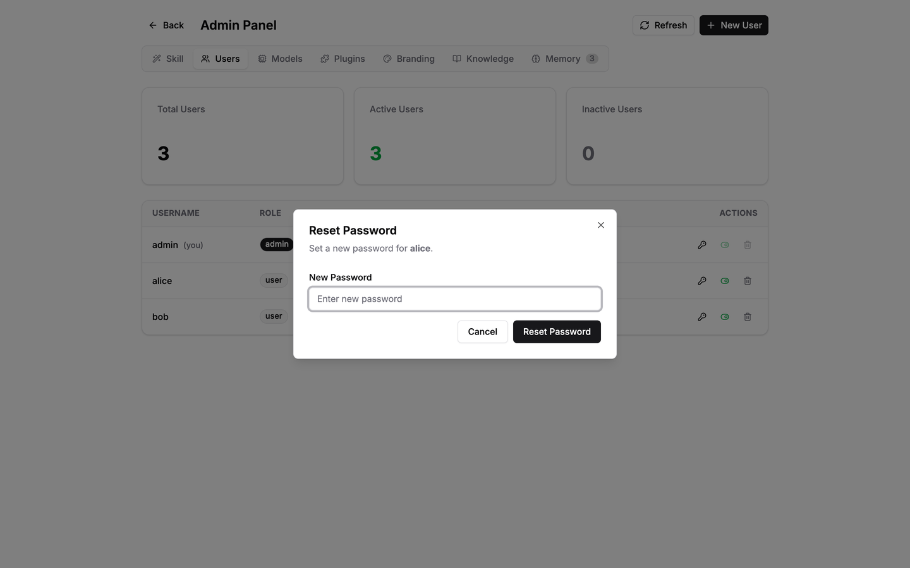

每个用户只看得到自己的会话。

### 6.3 Models

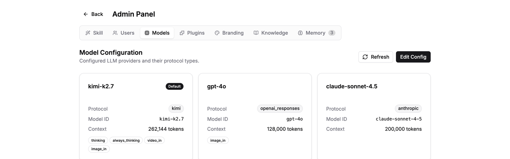

每张卡是一个已配置的模型：协议类型（`kimo` / `openai_responses` / `openai_legacy` /
`anthropic` / `gemini` …）、Model ID、上下文长度、能力标签（`thinking`、`image_in`、`video_in` …），
默认模型带一个 `Default` 徽章。

「Edit Config」直接编辑 `config.toml`（对话框标题上写着文件路径）：

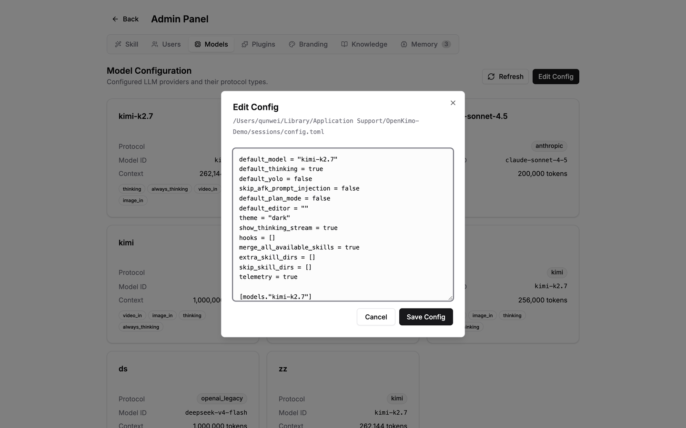

> 截图里的 `api_key` 已经打码。这个文件里是明文密钥，共享截图前记得处理。

一个模型的最小写法：

```toml
default_model = "gpt-4o"

[providers.gpt-4o]
type = "openai_legacy"
base_url = "https://api.openai.com/v1"
api_key = "sk-..."

[models.gpt-4o]
provider = "gpt-4o"
model = "gpt-4o"
max_context_size = 128000
```

保存后模型列表会立刻刷新。

### 6.4 Plugins

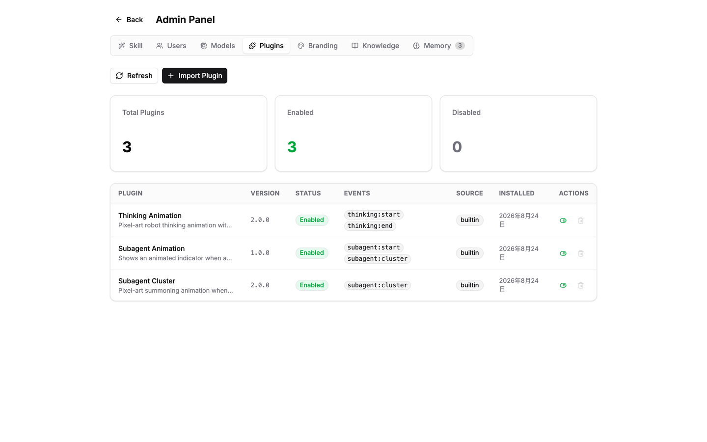

UI 插件把自定义 React 组件挂到 agent 生命周期事件上（`thinking:start`、`subagent:cluster` …）。
表格里是版本、状态、监听的事件、来源（`builtin` / 导入）、安装时间。内置的三个负责思考动画和子代理可视化。

「Import Plugin」从一个 URL 导入：

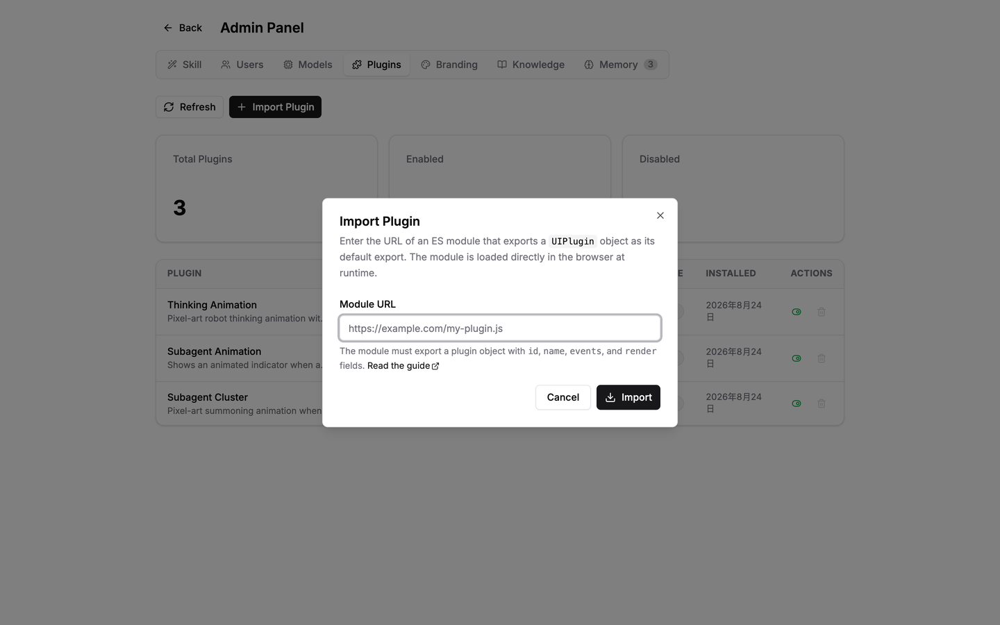

填一个 ES module 的 URL，模块要**默认导出**一个 `UIPlugin` 对象，至少包含 `id`、`name`、
`events`、`render` 四个字段。模块在浏览器里运行时直接加载，所以这个 URL 必须是浏览器够得到的地址。

### 6.5 Branding

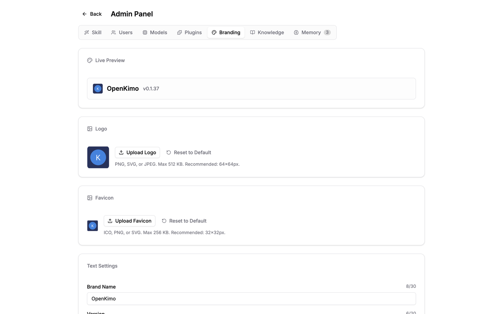

白牌需要的东西都在这一页，改完即时生效，不用重新构建：

| 字段 | 限制 |
|---|---|
| Logo | PNG / SVG / JPEG，≤512 KB，建议 64×64 |
| Favicon | ICO / PNG / SVG，≤256 KB，建议 32×32 |
| Brand Name | ≤30 字符 |
| Version | ≤20 字符 |
| Page Title | ≤60 字符 |
| Logo URL | 点击 logo 跳转到哪 |

最上面是 Live Preview，「Reset to Default」逐项还原。
如果你要连 app 名字、CLI 命令、bundle id 一起换，那是打包期的事，见 [7.4](#74-白牌打包)。

### 6.6 Memory

记忆面板有三个子页签，页签角标上的数字是**待批准的提案数**（在别的页签下也算，不会漏）。

**Persistent** —— 已入库的长期记忆，四种类型 User / Feedback / Project / Reference。
可以直接在这里加、改、删：

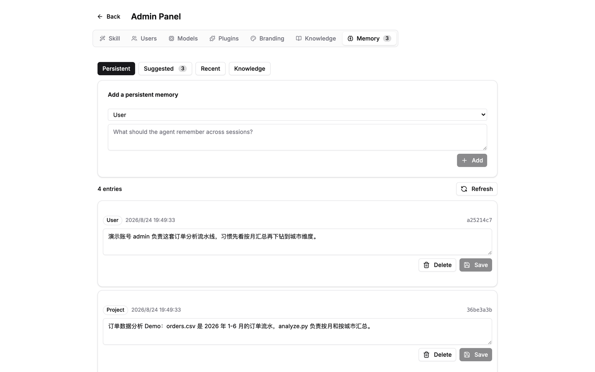

**Suggested** —— 抽取出来、**等你点头**的提案。这是整套记忆机制的闸门：抽取只负责提议，
入库要人决定。「Keep」写入长期记忆，「Discard」丢弃；两周没人管的提案会自动过期。

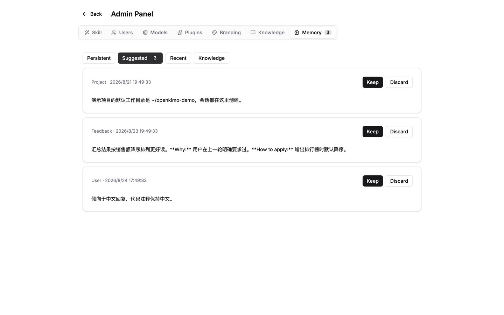

**Recent** —— 会话摘要，每条标着触发方式（`manual` 是你手动点的「保存记忆」，`compaction`
是压缩上下文时自动产生的，`session_end` 是会话结束时产生的）：

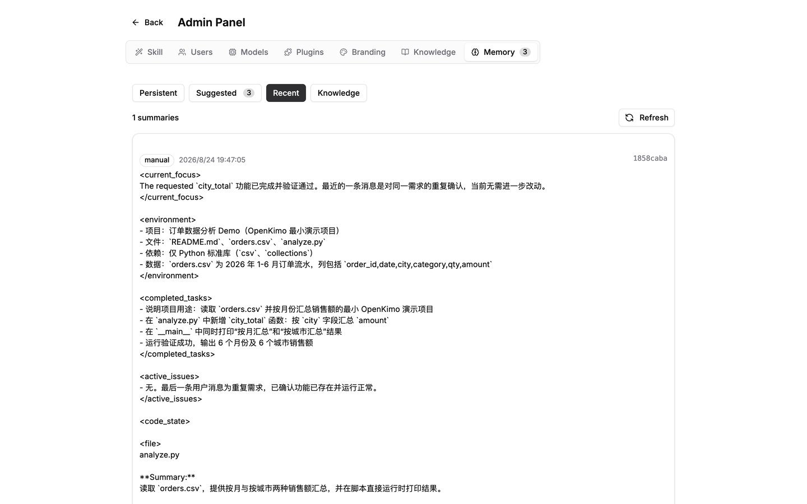

> 以前这里还有第四个子页签 Knowledge，因为必须先选中一个会话才能用，已经去掉。工作区知识已并入全局知识库，见 [6.7](#67-知识库)。

### 6.7 知识库

Wiki 是**一份跨会话、跨工作目录的长期知识库**。Memory 记的是"关于你的事"，
Wiki 记的是"查证过的知识"——一个结论、一份对比、一个实体的来龙去脉。

你在三个地方与它相遇：agent 提议写入时弹出的**审批卡片**、Admin Panel 的 **Wiki 页签**，以及磁盘上的 Markdown 文件。

**Admin → Wiki 页签。** 按分类列出所有页面，支持全文搜索；点开一页能看到标签、来源和它引用的其他页面。
可以**新建、编辑、删除**页面，写错的内容不必等 agent 哪天自己改。页面下方还有 **Health**（Wiki 自带的健康检查结果）
和 **History**（每一次变更的记录）。

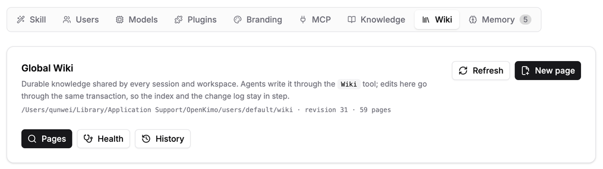

- 你的修改和 agent 的写入走同一套流程，目录、变更流水、版本号会一起更新。
- 打开页面之后它又被别人改过，保存会被拒绝，提示你重新加载，不会悄悄覆盖。
- 你手写不需要经过下面说的价值闸门，但页面规则照旧：密钥、本机绝对路径、`file://` 链接一律不让存。

**存在哪。** macOS 应用是 `~/Library/Application Support/OpenKimo/users/default/wiki/`，
可以用环境变量 `OPENKIMO_WIKI_ROOT` 指到别处。目录结构是固定的六个分类加四个特殊文件：

```
wiki/
├── entities/      具体的人、产品、系统
├── concepts/      概念与机制
├── comparisons/   对比结论
├── sources/       来源记录
├── queries/       查过的问题
├── lint/          结构问题
├── index.md       目录
├── overview.md    总览
├── log.md         变更流水
└── schema.md      本 Wiki 的写作规范
```

全是纯 Markdown，可以直接看、直接备份、直接用 git 管起来。

**agent 怎么用它。** 只有一个工具，六个动作：`search`、`read`（查与读）、
`remember`、`ingest`（写，需要你批准）、`lint`、`discard`。**只有主 agent 能用**——
子 agent 调它会被拒绝，理由是子 agent 的输出没有经过你，不该直接沉淀成长期知识。

**写入前有两道闸门，你只会看到第二道。**

1. **价值闸门（你看不见）。** 候选内容要么伴随**你明确的记录意图**（你说了"记住"
   "记到知识库"这类话），要么有**可靠来源**，否则直接丢弃，根本不会来问你。所以
   agent 不会因为聊到什么就攒一堆东西让你审。另外 `ingest` 只接受**当前这一轮的
   内容**或**已注册工作区里的相对路径文件**——它不能凭空引用别处的文件。

2. **审批卡片（你看得见）。** 和执行命令、修改文件是同一套卡片（见 [5.1](#51-审批卡片)），
   摘要里列出：要写哪些页面、来源是什么、跳过了哪些重复页。

> **这里有一个和别处不同的地方，值得记住：afk 不会自动放行 Wiki 写入，YOLO 会。**
> [5.2](#52-三道闸门) 说人工审批会被 YOLO / afk 跳过。Wiki 写入用的是只在本会话生效的
> 审批策略，所以 afk 那种"没人在场就一路放行"对它无效——卡片照弹，等你回来点。
> 但显式开 YOLO 是另一回事：那是你亲手表达的"这一程别拦我"，Wiki 写入和别的工具一样
> 直接放行。「本会话内同意」这种动作级授权同样有效。
>
> 所以开 YOLO 之前值得想一下：长期知识库写错一条，影响的是**以后所有会话**。

**拒绝是安全的。** 记录知识是 agent 正在做的事情的副产品，不是那件事本身，
所以你点「拒绝」不会中断当前这一轮——它记下"这次没记"，然后继续干活。

**写错了格式也不会白费。** agent 更新已有页面时忘了带版本号，或者 `ingest` 忘了带来源，
会收到一条说明该补什么的报错，改正后可以接着写，这次记录的机会不会因为这种小错误而作废。

### 6.8 MCP 服务器

MCP（Model Context Protocol）服务器是给 agent **外接工具**的标准方式——浏览器控制、
第三方系统的读写接口、公司内部的检索服务，都可以做成一个 MCP 服务器挂上来。
挂上之后，它提供的工具和 OpenKimo 自带的工具一样，出现在模型的工具列表里。

这个页签编辑的是 `~/.kimo/mcp.json`，**和命令行 `kimo mcp` 是同一份文件**。
在哪边改都行，改完另一边刷新就能看到。

**一个服务器长什么样。** 两类：

- **远程**（http / sse）—— 填一个 URL，可能再加几个 header 放 API Key。
- **本地**（stdio）—— 填一条命令，OpenKimo 把它作为子进程拉起来，用标准输入输出说话。

**「Test」按钮是这里最值得用的东西。** 它当场连一次，把服务器提供的工具列出来。
填错 URL、Key 过期、命令不存在，都在这一步看见，而不是等到某次会话里模型莫名其妙少了工具。

**密钥是掩码显示的。** header 的值、环境变量的值，界面上显示成 `***后四位`。
**原样提交就是"不改"**，想换就直接输入新的。只有「Edit JSON」那个入口会显示文件原文——
它是逃生舱，表单表达不了的字段（比如单独的超时设置）在那里改。

**改完什么时候生效。** MCP 服务器是在会话启动时连接的，所以保存之后**空闲会话会自动重启**
来接上新配置；**正在生成回答的会话会被跳过**，界面会告诉你跳过了几个，它们下次重启时才生效。

**stdio 有一道额外的闸门。** 一条 stdio 配置就是一条在宿主机上执行的命令——
这意味着能进管理面板的人，就能让服务器跑任意命令。所以：桌面版允许（那本来就是你自己的机器），
**Docker / 服务器部署默认不允许**，要放行得显式设置环境变量 `KIMO_WEB_ALLOW_STDIO_MCP=1`。
在宿主机上用 `kimo mcp add` 不受这个限制。

**需要 OAuth 的服务器**目前还得去终端跑一次 `kimo mcp auth <名字>`（会打开浏览器），
面板只负责告诉你"这个还没授权"。

**会话里能看到什么。** 会话启动连接服务器时，消息区会出现一条「Connecting to MCP servers…」。
全部连上，它就消失；**有服务器连不上或没授权，它会变成一行说明并点名是谁**——
因为那台服务器的工具在这个会话接下来的时间里都是缺失的，不说一声你不会知道。

### 6.9 自进化（Evolution）

让 agent **从自己的真实任务里学习**。整套机制分三层：

- **证据收集（永远开着，不花钱）**：agent 每完成一个任务，自动记录步数、token 消耗和完成状态。
  什么都不用开，正常使用就会积累。
- **改进（在这个页签一键操作，花 token）**：分析证据、提出一处 harness 改进（提示词追加段或技能），
  然后对真实任务**双跑验证**（基线 vs 改动后，同一任务各跑一遍），你看完对比证据再决定采纳。
  验证的开销约为普通运行的 2–5 倍，所以整条改进链由一个总开关授权——开关不开，一粒多余的 token 都不会花。
- **生效与回退（采纳后自动）**：采纳的改进自动应用到**此后新启动的会话**。每一次采纳记作「一代」，
  任何一代都能一键回退/前进，单个改进也能单独停用，全部操作留审计日志。

页签内部分四块：**总览 / 证据 / 改进 / 版本**。

**总览**：改进总开关（就是上面说的那个授权）、证据积累量、当前在第几代、最近审计记录。

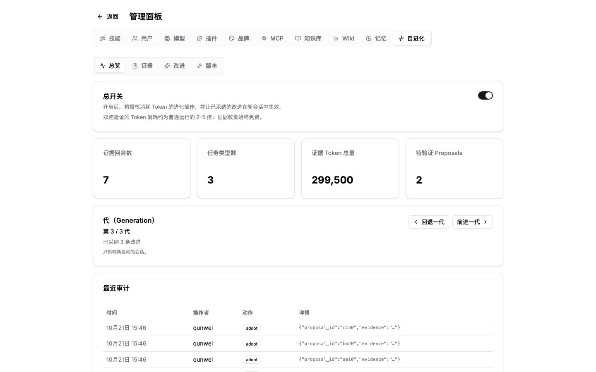

**证据**：任务类型成本表——哪类任务最费 token、哪类最容易失败，按问题程度排好序。
对着某一行点「据此改进」，就带着这个方向直接发起提案。

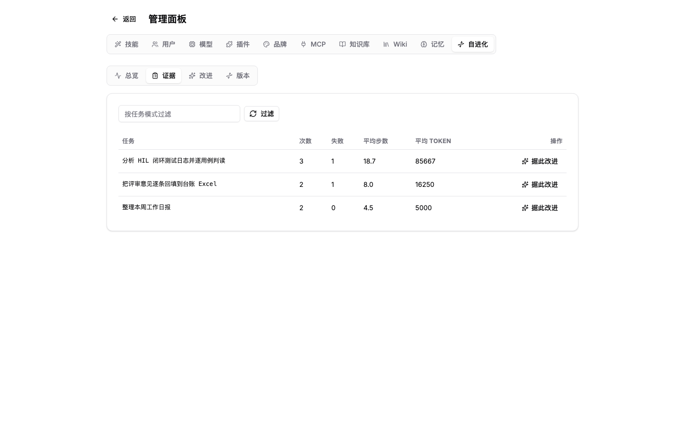

**改进**：提案卡片（理由、针对的任务、编辑器用量）。「双跑验证」前会明示开销
（将对 N 个任务各执行 2 次运行）；验证完成后展开对比表——每个任务的步数、token、差异百分比
和判定徽标，确认后点「采纳」。**采纳要求先有验证证据**，没验证过的提案采纳不了。

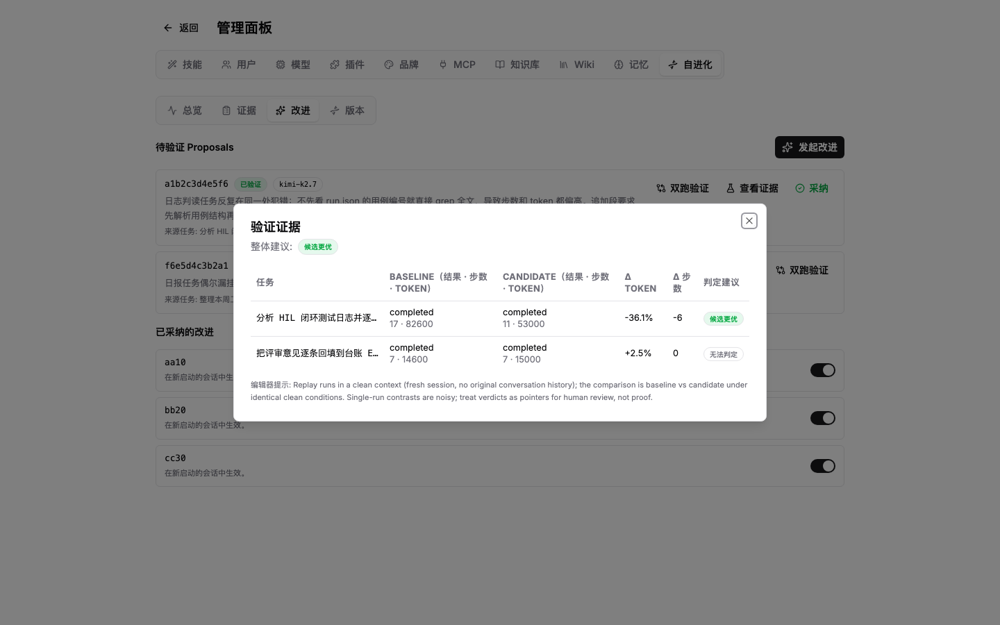

**版本**：代时间线，当前代高亮，「回退一代 / 前进一代」按钮在旁边。
回退只影响**新启动的会话**——正在运行的会话保持已挂载的改进不变。

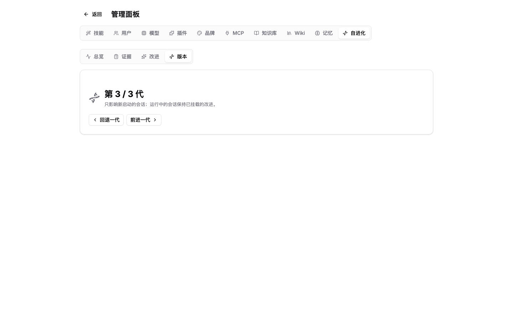

**建议的用法**：重复性高的任务（定期报告、评审、同类分析）攒几天证据再跑第一圈，改进最容易回本。
每次验证从 1 个任务起步，看 evidence 靠谱再加大。

---

## 7. 进阶

### 7.1 自己写一个 Skill

一个 skill 就是一个目录加一个 `SKILL.md`。最小例子：

```markdown
---
name: csv-report
description: 把一份订单 CSV 汇总成中文日报，按月、按城市两个维度输出。当用户说"出日报""汇总一下订单"时使用。
category: data
---

# CSV 日报

## 步骤

1. 读取 CSV，确认字段。
2. 按月汇总，保留两位小数。
3. 按城市汇总，降序排列。
4. 输出 Markdown 表格，附一句结论。
```

`description` 是给模型看的**触发条件**，写清楚"什么时候用"，比写"这个 skill 很有用"有效得多。
装法两种：Admin → Skill → Upload Skill；或者 Docker 部署时把宿主机目录挂进去
（`CUSTOM_SKILLS_HOST_PATH`），每个子目录一个 skill。

### 7.2 自定义 Agent

放在 `~/.kimo/agents`（用户级）或工作目录的 `.kimo/agents`（项目级），新建会话时在
「高级设置 → 智能体」里选。写法见 [`docs/CUSTOM-AGENTS.md`](CUSTOM-AGENTS.md)。

### 7.3 UI 插件

事件驱动，把 React 组件注入 agent 生命周期，不用动核心代码。导入方式见 [6.4](#64-plugins)。

### 7.4 白牌打包

```bash
cd packaging
python build.py --app-name="ACME Agent" --bundle-id=com.acme.agent \
                --icon=./acme.png --logo=./acme-logo.png --favicon=./acme-fav.png
```

路径、CLI 命令名、SQLite 里的品牌字段都从 `--app-name` 推导，所以多个品牌可以在同一台 Mac 上共存。
完整选项见 [`packaging/README.md`](../packaging/README.md)。

### 7.5 备份

要备份的只有一个目录：`KIMO_SESSION_DATA_DIR`（桌面版是
`~/Library/Application Support/OpenKimo/sessions/`）。里面是会话历史、`users.db`、`config.toml`。
`.env` 里有密钥，单独存，别进 git。

---

## 8. 排错

**打不开 5494**
端口被占：Docker 路线改 `.env` 里的 `KIMO_WEB_PORT` 再重启。
桌面版先看菜单栏是不是 `● Running`。

**一直卡在"正在连接…"或"正在启动环境…"**
worker 进程起不来。桌面版看 `~/Library/Logs/OpenKimo/server.log`，
Docker 看 `docker compose logs -f`。常见是 Python 依赖层不匹配，或者 API Key 没配。

**对话框里出现"连接错误"加一段 traceback**
worker 崩了，traceback 就是原因，照着查即可。改完配置后重启服务再试。

**API Key 无效**
表现是消息发出去后立刻报错。去 Admin → Models 确认默认模型的 provider 配置，
或直接改 `config.toml`。

**一直显示「服务端限流 · 第 N 次重试」**
这是模型服务商在限流（HTTP 429），通常是额度或调用频率到了上限，OpenKimo 会一直重试到它恢复。
不想等就点「停止生成」；经常遇到就去服务商那边看额度，或者在 Admin → Models 换一个模型。

**应用里的 skill 报 `node: command not found`**
从访达或 Dock 打开的应用拿不到终端里的 PATH，Homebrew、nvm 装的 node 都找不到。v0.3.0 起应用启动时会向你的登录 shell
要一次 PATH，已经解决。还报的话，先在终端里跑 `which node` 确认装了；装了就从菜单栏 Restart Server。
如果是上传的 skill 缺 npm 包，见 [6.1](#61-skill) 的 Install dependencies。

**Windows 上 Shell 工具用不了**
界面顶部会给一条横幅提示装 Git for Windows，装完点「刷新」。

**Docker 下创建会话失败**
先看是不是撞到 `MAX_SESSION_CONTAINERS`（默认 50），再看宿主机磁盘和内存。

**记忆状态灯一直是红的**
上次保存记忆失败。多半是模型调用失败或磁盘写不进去，日志里会有。

**隔一天回来要重新登录**
v0.1.37 之前会话是从登录那刻钉死的 24 小时，中途不续期，前端也只在页面加载时校验一次 —— 所以表现是"页面看着还在，其实已经掉线，刷新才弹登录页"。现在窗口会滑动（用着就不会掉），过期时也会自动跳回登录页。还想更久就把 `KIMO_WEB_SESSION_MAX_AGE` 调大；桌面版默认已经是 30 天。

**忘了 admin 密码**
用另一个 admin 账号去 Users 页重置。如果只有一个 admin，只能删掉
`<sessions 目录>/users.db` 让它重建默认账号 —— 用户和权限会丢，会话历史不受影响。

---

## 9. 附录

### 附录 A：常用环境变量

只列最常改的，全量见 [`.env.example`](../.env.example)。

| 变量 | 默认 | 说明 |
|---|---|---|
| `OPENAI_API_KEY` / `ANTHROPIC_API_KEY` | — | 至少配一个 |
| `LLM_PROVIDER` | — | 默认 provider（`openai_legacy` / `anthropic` / `gemini`） |
| `LLM_THINKING` | `false` | 默认是否开思考模式 |
| `KIMO_WEB_PORT` | `5494` | Web 端口 |
| `KIMO_WEB_SESSION_TOKEN` | — | Bearer Token，公网部署必须设 |
| `KIMO_WEB_SESSION_MAX_AGE` | `86400` | 登录会话的**空闲**窗口（秒）。窗口是滑动的，期间有请求就往后推 |
| `KIMO_WEB_SESSION_ABSOLUTE_MAX_AGE` | `2592000` | 从登录起算的硬上限（秒），永不延长。桌面版把空闲窗口默认设成 30 天 |
| `KIMO_WEB_ALLOWED_ORIGINS` | `*` | 允许的跨域来源 |
| `KIMO_WEB_LAN_ONLY` | `false` | 只允许局域网访问 |
| `KIMO_SESSION_DATA_DIR` | — | 会话/用户数据持久化目录（要备份的就是它） |
| `SANDBOX_CPU_LIMIT` | `2` | 每会话 CPU |
| `SANDBOX_MEMORY_LIMIT` | `4g` | 每会话内存 |
| `SANDBOX_DISK_LIMIT` | `10g` | 每会话磁盘 |
| `SANDBOX_TIMEOUT_SECONDS` | `86400` | 容器空转多久销毁 |
| `MAX_SESSION_CONTAINERS` | `50` | 同时运行的会话容器上限 |
| `BLOCK_DANGEROUS_COMMANDS` | `true` | 拦截 `rm -rf /` 一类命令 |
| `ENABLE_BROWSER` / `ENABLE_JUPYTER` | `true` | 仅 Docker 路线有效 |
| `CUSTOM_SKILLS_HOST_PATH` | — | 宿主机 Skill 目录，挂进每个沙箱 |

### 附录 B：斜杠命令速查

`/init` `/compact` `/clear` `/yolo` `/afk` `/plan` `/add-dir` `/export` `/import`，
外加每个已安装 skill 的 `/skill:<名字>`。

### 附录 C：术语

| 词 | 意思 |
|---|---|
| Session | 一段对话 + 一个工作目录，Docker 下还对应一个容器 |
| Sandbox | 会话专属容器 |
| Skill | 一段告诉模型"遇到这类活怎么干"的 Markdown |
| Agent | 一套人格 + 工具集，新建会话时选 |
| 知识库 | 跨会话、跨工作目录的长期知识库，存在应用数据目录下，agent 提议写入、你批准（[6.7](#67-知识库)） |
| Knowledge | 已移除：并入全局知识库（[6.7](#67-知识库)） |
| Persistent memory | 已入库的长期记忆 |
| Candidate / Suggested | 抽取出来、等人批准的记忆提案 |
| Carryover | 把上一段对话的结论带到下一段的机制 |
